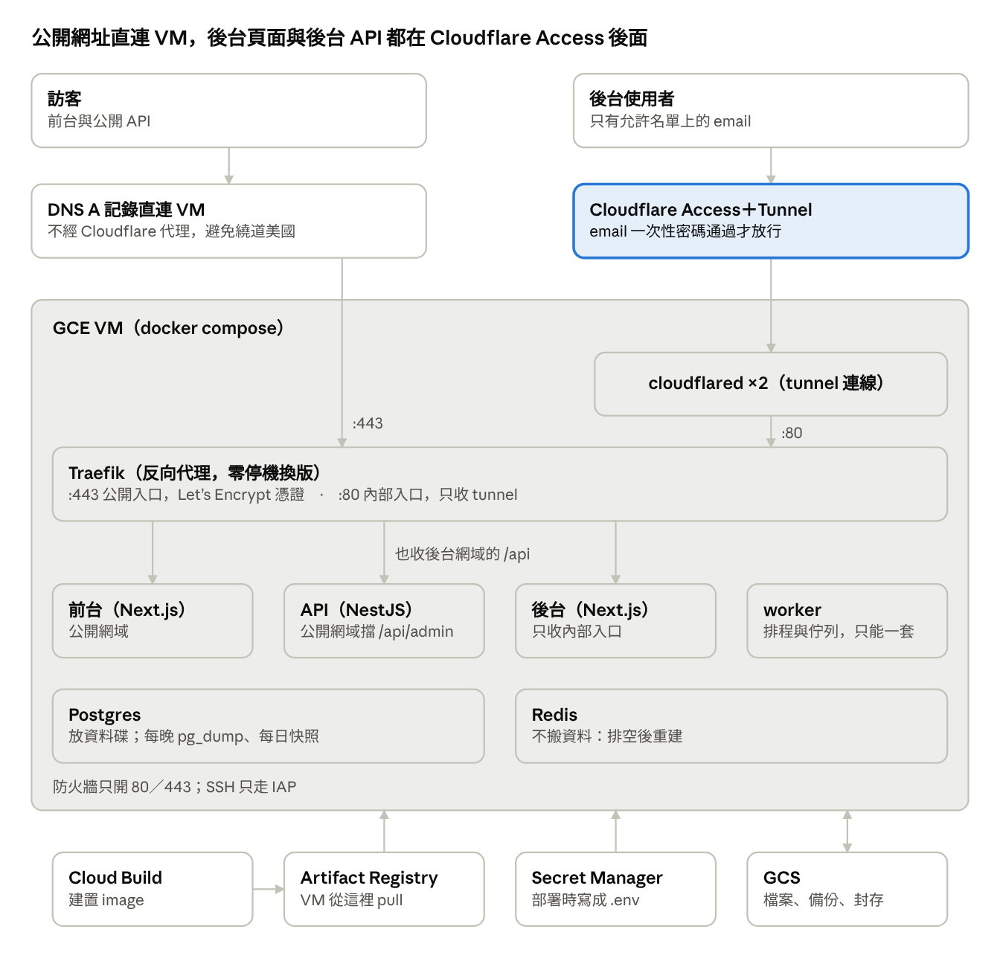
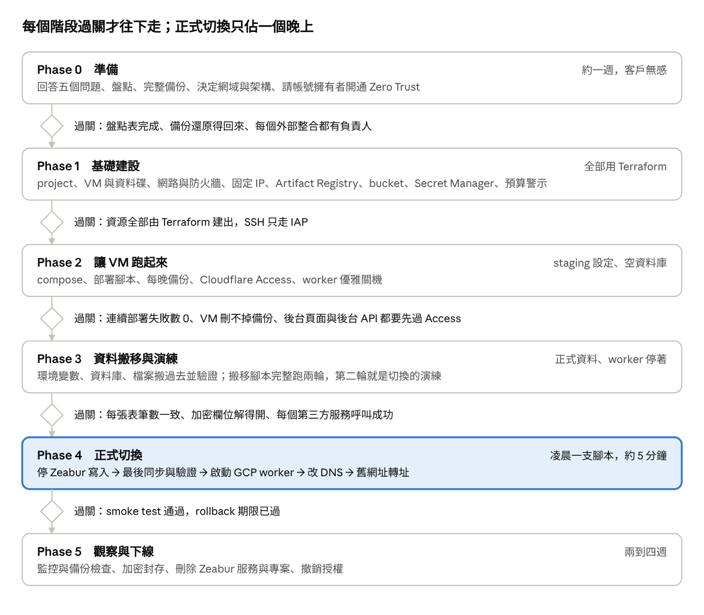

# Zeabur → GCP 遷移指南

把 Zeabur 上的前台、API、背景 worker、Postgres、Redis 和物件儲存，搬到 GCP 的一台 VM 用 docker compose 執行：每月約 US$40，正式切換約 5 分鐘，換版可以做到零失敗。真正的風險不在資料，而在綁著 `*.zeabur.app` 的外部連結、兩套 worker 同時碰正式資料、加密金鑰，以及部署設定裡看不見的差異。

這份整理自一次實際搬遷（Next.js 前台與後台、NestJS API、BullMQ worker），寫成任何專案都能照著走的版本。指令與腳本裡的 `<...>` 換成自己的值即可；腳本在 [`scripts/`](../scripts/) 與 [`templates/`](../templates/)。

## 目錄

1. [開工前先回答的五個問題](#開工前先回答的五個問題)
2. [選架構](#選架構)
3. [目標架構](#目標架構)
4. [盤點：要搬什麼、要改什麼](#盤點要搬什麼要改什麼)
5. [工作流程](#工作流程)
6. [各階段檢查清單](#各階段檢查清單)
7. [要準備的文件](#要準備的文件)
8. [不停機部署](#不停機部署)
9. [切換當晚](#切換當晚)
10. [下線 Zeabur](#下線-zeabur)
11. [陷阱一覽](#陷阱一覽)

## 開工前先回答的五個問題

任何一題答不出來，就先別動工。

1. **為什麼要搬？** Zeabur 的台灣機房本來就在 GCP 上，搬過去延遲不會變好。實際的收益是：可控的備份、完整的日誌、Secret Manager 的版本管理、IAM 與稽核、多個專案集中管理。如果主要是為了省錢要小心：Cloud SQL、Memorystore、Load Balancer 都有固定的最低費用，小流量時 GCP 可能比 Zeabur 貴，先拿目前的月帳單來比。
2. **有哪些外部系統綁著 `*.zeabur.app` 網址？** 這是最大的風險，比資料還大。列出所有 webhook（通訊軟體、金流）、OAuth／登入 callback、LIFF 之類的 endpoint、已經寄出的 magic link 與追蹤連結、印出去的 QR code、聊天機器人的選單、電商後台裡的連結。最穩的做法是先在 Zeabur 上換成自有網域，切換當晚只改 DNS。
3. **資料有多大、是什麼版本？** 量資料庫大小、Postgres 的 major 版本與 extension、物件儲存的檔案數與總量。這些數字決定停機窗口；目標資料庫用同一個 major 版本。
4. **合作方有沒有 IP 白名單？** VM 出站用固定 IP。有白名單的話，切換前就要把新 IP 給對方。
5. **這適合當第一個搬的專案嗎？** 有個資、金流、排程與佇列的專案最複雜。手上有多個專案時，先拿無狀態或只有一個資料庫的專案跑完整流程，把模板和腳本磨順。

## 選架構

小流量的專案選單機（C）最划算，代價是單點故障與要自己維運。費用是 asia-east1 的粗估（±30%），以 [GCP Pricing Calculator](https://cloud.google.com/products/calculator) 為準。

| 方案 | 組成 | 約略月費（US$） | 適合 |
| --- | --- | --- | --- |
| A. 全託管 | Cloud Run＋Cloud SQL＋Memorystore＋Load Balancer | 150–230 | 需要 SLA 與自動擴縮、不想管機器 |
| B. 平衡 | 同 A，但 Cloud SQL 用小規格（沒有 SLA），Redis 與 worker 放一台小 VM | 80–120 | 中等流量 |
| C. 單機 | 一台 e2-medium VM 跑 docker compose：Traefik、前台、API、worker、Postgres、Redis；GCS 放檔案與備份 | 約 40 | 小流量、預算有限、能接受單點 |

選單機前要先接受的代價：

- **單點故障**：VM 或 zone 掛掉就全站停機，從快照重建約 30–60 分鐘，要實際演練一次。
- **沒有時間點還原**：每天一次 `pg_dump` 加一次磁碟快照，最多遺失約一天的資料。要更好就加 WAL 歸檔。
- **作業系統與 Docker 自己顧**：開 unattended-upgrades，核心更新的重開機要自己排。
- **GCP 後台只看得到一台 VM**：各服務在 VM 裡的 docker compose，團隊要知道去哪裡看。

之後需求變高，可以只把資料庫搬到 Cloud SQL，其他不變。每個產品一個 GCP project，帳單與權限互相隔離；多個專案共用 Cloud SQL、Redis、LB 可以攤掉固定成本。

## 目標架構

訪客直連 VM 的 :443；後台頁面與它呼叫的 `/api` 都先過 Cloudflare Access，再經 tunnel 進到只收內部流量的 :80。worker 不接 HTTP 流量，只處理排程與佇列。設定範本見 [`templates/compose.example.yaml`](../templates/compose.example.yaml)。

## 盤點：要搬什麼、要改什麼

Postgres 與物件儲存要搬，Redis 不搬（排空後在 GCP 重建），環境變數要逐一分類。

| 存放處 | 做法 | 理由 |
| --- | --- | --- |
| Postgres | 停機窗口內 `pg_dump -Fc` → 取回 → 驗 SHA-256 → 在 VM 上換一個全新的資料目錄再 `pg_restore`（每次部署都跑 migrate，VM 上的資料庫不是空的），每張表筆數一致才算過（[`sync-db.sh`](../scripts/sync-db.sh)） | 唯一的真實來源；小資料量用不到 Database Migration Service，Zeabur 市集版 Postgres 也多半沒開 logical replication |
| 物件儲存（MinIO） | 直接複製到 GCS，object key 不變；比對數量與大小（[`sync-assets.sh`](../scripts/sync-assets.sh)） | 資料庫只存 key 時不必改資料；現有的 S3 client 透過 GCS 的 S3 相容介面不用改程式 |
| Redis | 不搬，改成排空：停 API → 等 worker 把佇列清到 0 → 停 worker → GCP 用全新的 Redis | 排程在 worker 開機時重新註冊；代價是 Redis 裡的登入 token 消失，使用者要重新登入 |
| 環境變數 | 整份放進 Secret Manager，逐一分類（[`sync-env.sh`](../scripts/sync-env.sh)） | 見下表 |
| 從外部同步來的資料（電商訂單等） | 跟上游系統的總數比對，不只比 Zeabur 與 GCP | 兩邊一致不代表完整：同步程式本身的漏洞會一起被搬過去 |

環境變數怎麼分類：

| 類別 | 例子 | 做法 |
| --- | --- | --- |
| 一個 byte 都不能改 | 欄位加密金鑰 | 改了就等於所有加密欄位讀不出來。兩邊各算一次 SHA-256 指紋比對，不要用肉眼看；另存一份離線備份；搬完後把所有加密欄位實際解一次 |
| 照抄 | JWT secret、第三方 API 金鑰 | 從 Zeabur 的變數備份匯入 |
| 要改 | `DATABASE_URL`、`REDIS_URL`、`S3_*` | 指向 compose 裡的容器與 GCS |
| 要改 | 對外網址、CORS、前端的 API 網址 | 換成新網域。Next.js 的 `NEXT_PUBLIC_*` 是建置時寫進 bundle 的，只改執行期的環境變數沒有用 |
| 要實測 | proxy 層數（Express 的 `trust proxy`） | 不同路徑的層數可能不同：直連是 1，經 Cloudflare tunnel 是 2。從外部偽造 `X-Forwarded-For` 測一次 |
| 拿掉 | `ZBPACK_*`、`PORT` | Zeabur 專用 |

外部整合與排程：

- **進站**（webhook、OAuth callback、寄出去的連結）：每一個都寫下切換當晚要改哪個後台、改成什麼。也在資料庫裡搜一次 `zeabur.app`，並查還有效的 magic link／登入 token 到什麼時候過期。
- **出站**（輪詢 API、呼叫 AI、寄信）：通常不用改，但要確認對方沒有 IP 白名單，也要對每個服務實際打一次最小的呼叫，確認金鑰還能用、還有額度。
- **排程與佇列**：同一時間只能有一套 worker 碰正式資料，否則提醒會重複發、對帳會重複跑。這是切換最容易出事的地方。

## 工作流程

關卡沒過就停在原階段處理。Phase 0–3 都不影響正式環境，可以慢慢來；風險集中在 Phase 4 那幾分鐘，所以要先演練過。

## 各階段檢查清單

複製這一節當成專案的工作清單（例如貼進 GitHub issue），做完一項勾一項。

**Phase 0　準備**（約一週，客戶無感）

- [ ] 寫下搬遷動機與每月預算上限，選定架構
- [ ] 盤點：`python3 -I scripts/zeabur-discover.py <專案>` 產出服務、image、volume、網域與環境變數名稱，以及適用性結論（[`zeabur-discover.py`](../scripts/zeabur-discover.py)）
- [ ] 量測：資料庫大小、Postgres 版本與 extension、物件數量與總量
- [ ] 完整備份到本機、專案目錄以外：環境變數（含加密金鑰，導向到只有自己能讀的檔案，不印到螢幕）、資料庫（`sync-db.sh --dump-only`）、物件（`fetch-minio-data.sh`）、app 的 volume（`sync-volume.sh --fetch-only`）
- [ ] 列出所有外部整合、排程與寄出去的連結
- [ ] 決定新網域；可以的話先在 Zeabur 上換成自有網域。沿用 Zeabur 上已綁的網域、切換當晚只改 DNS 的話，GCP 要在切換前拿到憑證：Traefik 改用 DNS-01（[compose 範本](../templates/compose.example.yaml) traefik 的註解），切換前用測試網域驗證
- [ ] 請 Cloudflare 帳號擁有者開通 Zero Trust，決定後台允許的 email 名單
- [ ] 本機 gcloud：確認預設 project 與 zone，腳本一律寫明 `--project`、`--zone`
- [ ] 確認合作方的 IP 白名單

**Phase 1　基礎建設**（全部用 Terraform：[`infra/`](../infra/)）

- [ ] project、帳單、Terraform state bucket（開版本控制）
- [ ] VM：系統碟與資料碟分開，資料碟設 `prevent_destroy` 並每日快照
- [ ] VPC、防火牆只開 80／443，SSH 只走 IAP
- [ ] 固定 IP（進出站同一個）、Artifact Registry（保留最新 N 版）
- [ ] 備份 bucket（VM 只能建立物件）、assets bucket、Secret Manager、預算警示

**Phase 2　讓 VM 跑起來**（staging 設定、空資料庫）

- [ ] 遷移的改動都在另一個分支：專案裡多一個 Dockerfile，Zeabur 下次建置就會改用它，所以不能進 Zeabur 部署的分支
- [ ] 每個 app 都有 Dockerfile，本機 `docker build` 過（Zeabur 常用 zbpack 自動建置，專案裡不一定有）
- [ ] compose：Traefik、前台、API、worker、一次性的 migrate、Postgres、Redis；image 由 Cloud Build 建置，不在 VM 上 build
- [ ] secret 的第一個版本：資料庫密碼、GCS 的 HMAC 金鑰、staging 用的加密金鑰（[`init-secrets.sh`](../scripts/init-secrets.sh)，在自己的終端機跑）；app 開機就要的其他變數用 staging 的值補上（[`set-env.sh`](../scripts/set-env.sh)）
- [ ] 後台：先建 Access 應用（[`cloudflare-access.py`](../scripts/cloudflare-access.py)），再建 tunnel 與 DNS（[`setup-tunnel.sh`](../scripts/setup-tunnel.sh)），中間沒有對外公開的空窗
- [ ] 公開網域的 DNS 直連 VM 的固定 IP，不開 Cloudflare 的 proxy
- [ ] 部署腳本：secrets → 清舊 image → pull → migrate → 逐一 rollout → worker → 清舊 image
- [ ] 第一次部署前：[`check-placeholders.py`](../scripts/check-placeholders.py) 沒有剩下的佔位值，`deploy/` 已 commit（只部署 commit 過的內容）
- [ ] 連續部署多輪，期間每 0.5 秒打一次各網址，失敗數必須是 0
- [ ] 每晚備份實際跑一次，並試刪一次，確認 VM 刪不掉備份
- [ ] worker 處理 SIGTERM，把手上的 job 做完才退出
- [ ] 從外部用真正的網址測：憑證、http → https、只有該開的 port 是開的、後台頁面與後台 API 都在 Access 後面

**Phase 3　資料搬移與演練**（正式資料，worker 停著）

- [ ] 資料庫：容器內 dump → 分片取回 → 驗 SHA-256 → 還原；每張表筆數一致。還原時 VM 進 standby，worker 從此停著
- [ ] 環境變數換成正式值；加密金鑰比對指紋；重新部署讓 VM 讀到新的 secret（`release.sh --deploy-only`）
- [ ] 檔案：MinIO 複製到 GCS（用只碰 assets bucket 的暫時金鑰，結束後刪除）；app 的 volume 搬到 VM 的資料碟（`sync-volume.sh`）；數量一致
- [ ] 驗證：加密欄位解得開、資料庫參照的檔案都在、公開 API 兩邊回傳相同內容
- [ ] 同步來的資料與上游系統的總數比對
- [ ] 每個第三方服務實際打一次最小的呼叫
- [ ] standby 期間不放會對外發訊息的正式憑證，避免用正式資料通知真實客戶：列進 `build-app-env.py` 的 HOLD，切換前一小時內才用 `sync-env.sh --live` 換成正式值（`cutover.sh` 會檢查）
- [ ] 搬移腳本（`sync-db.sh` → `sync-env.sh` 加重新部署 → `sync-volume.sh`／`sync-assets.sh` → `verify.sh`）完整跑兩輪，第二輪就是切換的演練，量出每一步要多久（`cutover.sh` 會暫停正式環境，不能拿來演練）
- [ ] 切換前至少一天，要改的 DNS 記錄 TTL 降到 300 秒

**Phase 4　正式切換**（凌晨，避開排程時間）

- [ ] 切換前一小時內：Zeabur 部署的分支合併進遷移分支、`sync-env.sh --live`、重新部署；有 MinIO 時建立暫時的 HMAC 金鑰（`sync-assets.sh --create-key`）
- [ ] 照「切換當晚」一節跑切換腳本
- [ ] smoke test：後台登入、表單送出、上傳、背景任務、匯出
- [ ] 舊前台換成轉址之後，刪掉暫時的 HMAC 金鑰（`sync-assets.sh --delete-key`）
- [ ] 宣告 rollback 期限（例如兩小時）：期限內有問題一律退回（[`rollback.sh`](../scripts/rollback.sh)），過了只能往前修
- [ ] 確定不退回後，遷移分支合併回 Zeabur 原本部署的分支（Zeabur 的自動部署已經停了）

**Phase 5　觀察與下線**（兩到四週）

- [ ] 舊網址都轉到新網域，路徑與參數保留（實際打深層連結與帶參數的連結）
- [ ] Uptime Check（檢查回應內容）與預算警示
- [ ] 通知團隊：新的後台網址，以及「合併到 main 不會再自動部署」
- [ ] 確認備份每天產生，並實際還原一次
- [ ] 確定不會 rollback 後，轉址從 302 改成 301（改轉址服務的 `Caddyfile`，再跑一次 `retire-zeabur-frontends.sh`）
- [ ] 期滿後照「下線 Zeabur」一節收尾

## 要準備的文件

七份文件裡，盤點表與切換 runbook 最關鍵：前者決定切換當晚要改哪些地方，後者決定出事時怎麼退。放在 repo 裡，跟腳本一起改。

| 文件 | 內容 | 何時定稿 |
| --- | --- | --- |
| 遷移計畫 | 動機、預算、架構決定與理由、風險清單、決定紀錄 | Phase 0 |
| 盤點表 | 每個服務、資料量、每個進站網址要改哪個後台、每個排程 | Phase 0 |
| 環境變數對照表 | 每個變數：照抄／要改／拿掉，以及新值從哪裡來 | Phase 1–3 |
| 部署說明（README） | 怎麼發佈、回滾、更新 secret、登入 VM，以及部署後要手動跑的指令 | Phase 2 |
| 切換 runbook | 每一步的指令、預估時間、驗證方式、失敗時怎麼辦 | Phase 3 演練後 |
| Rollback 條件 | 期限、觸發條件、退回步驟、誰有權決定 | 切換前 |
| 下線清單 | 封存位置與金鑰名稱、刪除順序、要撤銷的授權 | Phase 5 |

時間一律寫成 UTC 並註明日期。台灣凌晨的切換在 UTC 是前一天，紀錄很容易差一天。

## 不停機部署

Traefik 加 [docker-rollout](https://github.com/wowu/docker-rollout)，單機也能做到換版零失敗，但只靠 healthcheck 做不到，下面每一項都要。部署流程是：secrets → 清舊 image → pull → migrate → 依序 rollout 各 HTTP 服務 → worker → 清舊 image，任何一步失敗就停，舊版繼續服務（[`deploy.sh`](../scripts/deploy.sh)）。

**三個缺一不可的 Traefik 設定**

1. 到後端的 dial timeout 改成 1 秒（預設 30 秒會卡在已移除的容器 IP）。
2. 關掉到後端的 keep-alive（`serverstransport.maxidleconnsperhost=-1`），否則請求會送進正要關閉的連線，回 502 且不重試。
3. 排空：pre-stop hook 先建立 `/tmp/drain` 讓 healthcheck 失敗，等 Traefik 不再送流量（約 10 秒），再停舊容器。

**其他規則**

- **healthcheck 要看內容**：精簡 image 沒有 curl 與 wget，用 bash 的 `/dev/tcp` 或 Node 的 fetch；健康檢查端點在資料庫掛掉時可能仍回 200，要檢查回應裡的狀態欄位；記得設 `start_period`。
- **docker-rollout 的限制**：服務不能設 `container_name`，也不能把 port 開到主機上。只讓 Traefik 對外。
- **路由規則要改時，連名稱一起改**：rollout 期間新舊容器同時存在，同名路由的設定不同，Traefik 會把它丟掉，那個服務就中斷。
- **migration 向下相容**：換版那幾秒舊程式會跑在新 schema 上。新欄位要 nullable 或有預設值，刪欄位分兩次發佈；migration 與 seed 拆成一次性的 migrate 服務，不要綁在 API 開機。
- **部署前後都清舊 image**：每版約 4 GB，預設的 `docker image prune` 只刪沒有 tag 的，舊版會累積到系統碟滿。用 `docker image prune --all --force`；回滾時從 Artifact Registry 重新下載。
- **前端的 API 網址在建置時寫死**：要改就重新建置（[`cloudbuild.example.yaml`](../templates/cloudbuild.example.yaml)）。這樣檔名（content hash）會變，瀏覽器與 CDN 的快取不會沿用舊檔。
- **用數字驗證**：部署時另開一個探測迴圈（[`probe.sh`](../scripts/probe.sh)），每 0.5 秒打一次各網址，結束時失敗數必須是 0。

## 切換當晚

整段做成一支腳本（[`cutover.sh`](../scripts/cutover.sh)），要加 `--confirm` 才會執行；順序本身就是重點。建議排在台灣凌晨 02:00–03:30，避開排程時間；演練過的腳本約 5 分鐘跑完。

| # | 步驟 | 為什麼在這個位置 |
| --- | --- | --- |
| 0 | 最後一次同步檔案（MinIO、app 的 volume） | 都在 Zeabur 的容器裡執行，服務一暫停就做不了 |
| 1 | 停掉 Zeabur 的自動部署；暫停 API，等 worker 清空佇列，再暫停 worker | 從此 Zeabur 不再有新資料；不停自動部署，下次合併就會把服務叫醒 |
| 2 | 最後一次資料庫同步，每張表筆數比對 | 任何一張不一致就中止 |
| 3 | 驗證：API 健康（直接打 VM 的 IP）、資料庫參照的檔案都在、專案自己的檢查（例如解密） | 步驟 0 與 1 之間新上傳的檔案會在這裡被抓到 |
| 4 | GCP 離開 standby，啟動 worker | 最後才啟動，確保同一時間只有一套 worker |
| 5 | 改 DNS 與各外部後台的網址 | 照盤點表逐項打勾 |
| 6 | 等 DNS 生效，再把舊前台換成 302 轉址到新網域，路徑與參數保留 | 舊連結仍能用；回訪者的瀏覽器快取不會卡在舊 API。一定在 DNS 之後：舊前台若也掛著自有網域，DNS 還指向 Zeabur 時轉址會指回自己、無限循環（[`retire-zeabur-frontends.sh`](../scripts/retire-zeabur-frontends.sh) 會先檢查） |

**Rollback**（GCP 還沒有新寫入之前）：GCP 回 standby（移除 live 標記、建立 standby 旗標、停 worker）→ DNS 與外部後台改回 Zeabur → Zeabur 的自動部署改回原分支 → 恢復 Zeabur 的 API 與 worker → 已經換成轉址的前台從原分支重新部署（不能 restart：restart 沿用已被改寫的容器）。[`rollback.sh`](../scripts/rollback.sh) 執行 GCP 回 standby、自動部署改回原分支、恢復 API 與 worker，DNS、外部後台與前台的重新部署要人做，它最後會印出來。切換腳本在暫停 Zeabur 之後任何一步失敗，也是跑它，不要重跑切換腳本。`rollback.sh` 還沒有在真實的切換中跑過，切換前先讀一遍。GCP 一旦有新寫入，退回就要反向搬資料，所以切換前先定好 rollback 期限。

## 下線 Zeabur

切換後 Zeabur 的服務先暫停、不刪除，資料庫保留 2–4 週當 rollback 依據（這段期間 Zeabur 仍會收資料庫的費用）。期滿後照下面的順序收尾。

- [ ] **最後封存**：資料庫 dump 與物件儲存整包，用隨機金鑰做 AES-256 加密，金鑰只放 Secret Manager，檔案放 Archive class bucket。下載回來、用 Secret Manager 裡的金鑰解密、SHA-256 一致才算完成（[`fetch-minio-data.sh`](../scripts/fetch-minio-data.sh)、[`final-archive.sh`](../scripts/final-archive.sh)）。Archive class 有 365 天最低保存期，提早刪除仍照一年計費。
- [ ] **加密金鑰的離線備份**：存進密碼管理器，和 Secret Manager 裡的比對 SHA-256 指紋。secret 一被刪，所有版本都不見，加密欄位與每一份備份都解不開（Terraform 對 secret 設了 `prevent_destroy`，但手動刪除擋不住）。
- [ ] **刪掉本機的明文暫存檔與金鑰檔**（上一項做完之後）。
- [ ] **確認沒人在用舊網址再刪轉址服務**：資料庫裡存的連結、還有效的 magic link／登入 token、聊天機器人選單、印出去的 QR code、電商後台的連結。
- [ ] **刪除 Zeabur 服務，再確認一次**：`zeabur service delete` 即使顯示「刪除成功」，也只是先暫停，2 小時後才真的刪。這段期間 `service list` 仍看得到，可以用 GraphQL 的 `cancelDeleteService` 撤銷。用 [`zeabur-inventory.py`](../scripts/zeabur-inventory.py) 查 `scheduledDeleteAt`，到期後再查一次。
- [ ] **刪除空的 Zeabur 專案**：用專案 ID 刪，不要用名稱。
- [ ] **GitHub 授權只移除這個 repo**：在 GitHub 的 Zeabur App 設定移除該 repo 的存取權；帳號下還有別的專案時，不要整個解除安裝。
- [ ] **關帳號前列出帳號下所有專案與服務**：同一個 Zeabur 帳號常常還有別的正式網站。拿各網域打一次，回應帶 `x-zeabur-request-id` 就代表還在 Zeabur 上。
- [ ] **一併下線更早的部署**：舊主機、舊 Cloudflare tunnel、舊 DNS 紀錄。tunnel 連線的來源 IP 可以看出主機在哪個網路。

後台若要用 Cloudflare Access 保護，見 [`cloudflare-access.py`](../scripts/cloudflare-access.py) 與 [`scripts/README.md`](../scripts/README.md#cloudflare-access)。

## 陷阱一覽

每一條都是實際遇到的，大致依發生的階段排序。

| 階段 | 陷阱 | 症狀 | 做法 |
| --- | --- | --- | --- |
| 準備 | 本機 gcloud 預設值指向別處 | 指令打到別的 project、VM 開在香港 zone | 腳本一律寫明 `--project`、`--zone`；Terraform 用包裝腳本以使用者帳號執行，不讀 ADC |
| 準備 | Cloudflare Access 沒開通 | 切換後才發現後台對外公開；`cloudflared` 登入的憑證管不到 Access | 帳號擁有者先開通 Zero Trust（Free 方案也可能要綁信用卡）；另建有 Access 權限的 API token |
| 準備 | Zeabur CLI 登入過期 | 腳本第一步就 401 | `npx zeabur@<固定版本> auth login`；網站登入不會更新 CLI 的 token；腳本固定 CLI 版本 |
| 建置 | Docker Hub 匿名下載限制 | 建置偶發 429；平台顯示「部署成功」其實是建置失敗 | base image 改經 `mirror.gcr.io`；部署後確認實際跑的版本 |
| 建置 | 專案沒有 Dockerfile | Zeabur 上建置正常，Cloud Build 卻無從建起：Zeabur 是用 zbpack 自動判斷怎麼建 | Phase 2 先為每個 app 寫 Dockerfile，本機 `docker build` 過再上 Cloud Build |
| 建置 | Next.js 公開變數在建置時寫死 | 改了執行期的 `NEXT_PUBLIC_API_URL` 沒有效果 | 在建置參數改；不同前端要不同值時，各自一個參數 |
| 部署 | migration 與 seed 綁在 API 開機 | 每次換版、重啟都再跑一次 seed | 拆成一次性的 migrate 服務，失敗就停止換版 |
| 部署 | 系統碟被舊 image 塞滿 | 幾次部署後 pull 失敗：`no space left on device` | 部署前後都 `docker image prune --all --force` |
| 部署 | 同名路由在 rollout 時衝突 | 改路由規則的那次部署，服務中斷 | 改規則時連路由名稱一起改 |
| 部署 | 不在部署流程裡的資料 | 程式更新了，知識庫、商品清單還是舊的 | 把「部署後要手動跑的指令」寫進部署說明 |
| 網路 | Cloudflare 免費方案繞道美國 | 經 tunnel／代理時，台灣中華電信用戶每個請求多 0.3–0.4 秒 | 公開網址用 DNS 直連 VM（Traefik＋Let's Encrypt），只有後台走 tunnel＋Access；遇到攻擊再改回代理 |
| 網路 | 真實 IP 與限流 | 訪客 IP 全變成 proxy 的 IP，或訪客可以偽造 IP | Traefik 只信任內部網段的 forwarded headers；路徑層數不同時，app 除了層數也信任私有網段的 proxy（[`trust-proxy.ts`](../templates/trust-proxy.ts)）；從外部偽造 header 實測 |
| 網路 | Access 只擋網域 | 後台頁面擋住了，後台呼叫的 API 卻在公開網域上 | 後台的 API 走後台自己的網域；公開 API 網域拒絕後台路徑 |
| 網路 | 路徑比對大小寫 | Express 預設不分大小寫，`/API/Admin`、`/api//admin`、`/api/%61dmin` 都會路由到後台 | 阻擋規則用不分大小寫的 regex；用同版本 Traefik 實測各種變形（[`verify-admin-block.sh`](../scripts/verify-admin-block.sh)） |
| 資料 | Zeabur exec 輸出有上限且是 CRLF | 直接印出 dump，檔案被截斷或損壞 | 容器內 dump 成檔，base64 分 1 MB 片段取回，去掉 `\r`，比對 SHA-256（[`fetch-file.sh`](../scripts/fetch-file.sh)） |
| 資料 | MinIO 容器工具少、系統檔一直變 | 沒有 tar、gzip、find；`.minio.sys` 的 usage cache 取回後 checksum 對不上 | 用 sh 走目錄＋`dd`＋`base64`＋`sha256sum`；排除 `.minio.sys` 的 tmp、multipart、usage、bloom、heal 檔 |
| 資料 | 上傳的檔案存在 app 的 volume 上 | 以為檔案都在 MinIO，搬完才發現 app 服務自己掛了 volume（例如 `/data/media`） | 盤點時看每個服務的 volume（`zeabur-discover.py` 會列出）；搬到 VM 的資料碟、compose 掛回同一個路徑，兩邊比對檔案數（[`sync-volume.sh`](../scripts/sync-volume.sh)） |
| 資料 | 同步程式的漏洞一起搬過去 | Zeabur 與 GCP 筆數一致，跟上游卻差很多（例：分頁上限加上新到舊排序，舊資料從未匯入） | 同步來的資料跟上游總數比對；增量游標只在整輪讀完後前進 |
| 資料 | 備份 bucket 只能寫入 | `gcloud storage cp` 失敗 | 用 GCS JSON API 上傳（`ifGenerationMatch=0`）；實際試刪一次確認回 403 |
| 切換 | Zeabur 自動部署關不掉 | 暫停的服務在下次合併時被重新部署，變成兩套 worker | 用 Zeabur GraphQL `updateGitTrigger` 把分支改成不存在的名稱並驗證；repo 的 webhook 清單是空的不代表沒有自動部署，它走 GitHub App |
| 切換 | Zeabur restart 不套用新的環境變數改寫 | 改了前台的 API 網址再 restart，還是打舊 API | 用 redeploy（從 image 建新容器），不要 restart |
| 切換 | 回訪者卡在「載入中」 | 新訪客正常，以前來過的人打開舊網址一直轉圈 | Next.js 的 JS 快取一年且檔名不變；舊前台換成保留路徑與參數的 302 轉址 |
| 切換 | 搬過去的第三方金鑰沒額度 | 切換看似正常，AI 功能其實全部失敗 | 每個服務實際打一次最小的呼叫；換金鑰用隱藏輸入直接寫進 Secret Manager，再重新部署 |
| 維運 | 正式容器裡的除錯限制 | 沒有 ps、curl；在容器裡啟動整個應用程式測試會卡住，還留下孤兒程序 | 用最小的腳本加 `timeout`；找程序用 `/proc/*/cmdline` |
| 維運 | 驗證腳本自己出錯 | 監控一直顯示「沒有資料」，其實是查詢的引號寫錯；清理步驟欄位切錯，刪掉了剛取回的檔案 | 每個檢查加一個陽性對照；刪除步驟前先檢查清單長度，空清單就停 |
| 維運 | systemd 不支援行尾註解 | timer 的 `OnCalendar=... # 註解` 讓註解變成值的一部分 | 註解只寫在獨立的行 |
| 下線 | Zeabur 的刪除是延遲的 | CLI 說刪除成功，`service list` 仍看得到 | 查 GraphQL 的 `scheduledDeleteAt`；2 小時後再確認 |
| 下線 | 不明的舊部署還在跑 | 舊 tunnel 還有連線，主機找不到 | 盤點所有 tunnel、DNS、舊主機；tunnel 連線的來源 IP 可以定位網路 |

### 還沒遇過、但腳本已經防著的

- **redis-stack 的 `command` 被覆寫**：`redis/redis-stack-server` 的 entrypoint 靠自己的參數載入模組，compose 裡寫 `command: redis-server …` 會讓 RedisJSON、Search 都不見，用到的功能直接報錯。改用 `REDIS_ARGS` 環境變數設定參數（[compose 範本](../templates/compose.example.yaml)的 redis 註解，`zeabur-discover.py` 會標出來）。
- **轉址指回自己**：舊前台在 Zeabur 上同時綁著自有網域時，DNS 還沒切到 GCP 就換成轉址，自有網域會轉到自己、無限循環。轉址一律在 DNS 生效之後；`retire-zeabur-frontends.sh` 開始前會檢查新網址不是 Zeabur 回的、DNS 已指向 GCP。
